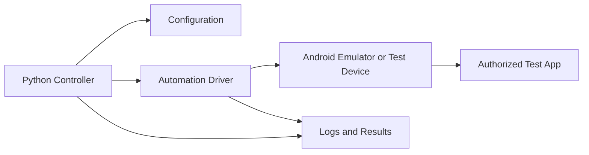
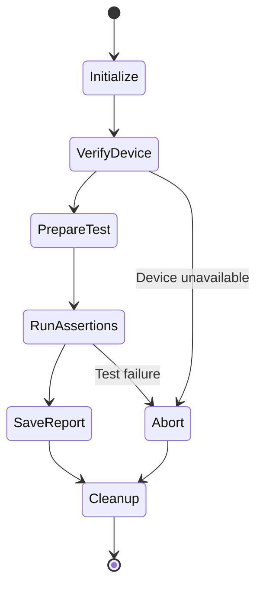

<div align="center">


<br/>

<a href="https://share.google/h6oDVTgcuOEFKbOpx"></a>
&nbsp;
<a href="https://share.google/h6oDVTgcuOEFKbOpx"></a>
&nbsp;
<a href="https://share.google/h6oDVTgcuOEFKbOpx"></a>

<br/><br/>


</div>

---

# 🌗 Snapchat Score Bot Automation

**Snapchat Score Bot Automation** explores Android device automation, repeatable interaction testing, and the engineering patterns behind mobile automation tools. The project theme brings together Python orchestration, device connectivity, UI inspection, event logging, and resilient test design in a Snapchat-related context.

Snapscore is a feature of Snapchat, but its exact calculation is proprietary and may change. Automation should not be presented as a guaranteed method for increasing a score. This guide focuses on the technology, workflow design, and responsible use of mobile test environments rather than promising any particular account outcome.

## 🪄 At a Glance — Feature Cards

<table>
<tr>
<td align="center" width="33%"><h3>🛰️ Device Connection</h3>Organize Android device discovery, connection checks, and emulator readiness.</td>
<td align="center" width="33%"><h3>🧩 Workflow Design</h3>Model repeatable steps with explicit states, timeouts, and predictable transitions.</td>
<td align="center" width="33%"><h3>🫧 UI Inspection</h3>Understand selectors, screen structure, and test element discovery.</td>
</tr>
<tr>
<td align="center"><h3>🪵 Structured Logs</h3>Track execution steps, errors, elapsed time, and useful diagnostic context.</td>
<td align="center"><h3>🧪 Test Environments</h3>Validate automation behavior in approved emulators and test applications.</td>
<td align="center"><h3>🧯 Failure Recovery</h3>Design safe retries, stop conditions, and cleanup procedures.</td>
</tr>
</table>


---

## 🧭 How the Automation Stack Fits Together

A mobile automation workflow usually includes a **controller**, a **device interface**, an **application under test**, and a **reporting layer**. Keeping these responsibilities separate makes debugging and maintenance easier.



| Layer | Typical responsibility | Examples |
|:--|:--|:--|
| Controller | Workflow coordination | Python scripts, task runners |
| Device bridge | Device detection and diagnostics | Android Debug Bridge (ADB) |
| UI driver | Automated interface testing | Appium |
| Test runner | Assertions and test organization | pytest |
| Configuration | Environment-specific settings | Environment variables, YAML |
| Observability | Execution records and troubleshooting | Python logging, test reports |

### Why separation matters

A controller should not have to know the details of every screen layout. Similarly, device connection logic should not be mixed with report formatting. Independent modules are easier to test, update, and replace when a mobile operating system or application interface changes.

---

## ⚙️ Engineering Principles

### 01 — Reliable device discovery

Check whether an emulator or authorized test device is connected before launching a workflow. Device identifiers should be configured explicitly in environments with more than one device.

### 02 — Predictable execution

Replace arbitrary sleeps with condition-based waits wherever possible. A well-designed test waits for the expected UI state and fails with a useful message if that state never appears.

### 03 — Reproducible configuration

Keep nonsecret configuration in a dedicated file or environment variables. Avoid hard-coding local paths, device IDs, or personal credentials in committed code.

### 04 — Clear observability

Record start and end times, test case names, driver errors, and sanitized diagnostic data. Good logs explain what happened without exposing sensitive account details.

### 05 — Responsible boundaries

Use only accounts, devices, and applications you are authorized to test. Respect platform rules and avoid unsolicited messaging, account manipulation, or attempts to bypass rate limits and abuse-prevention systems.

---

## 🛠️ Development Environment

For a Python-based Android automation project, the common development tools are:

| Tool | Role | Notes |
|:--|:--|:--|
| Python 3 | Automation scripting | Use a supported release |
| Android SDK | Device tooling | Includes ADB |
| Appium | UI automation server | Driver setup varies by platform |
| UiAutomator2 | Android automation driver | Used through Appium |
| pytest | Automated testing | Useful for assertions and fixtures |
| Git | Version control | Keep secrets out of commits |

### Example: create an isolated Python environment

```bash
python -m venv .venv
```

Activate it on Windows:

```powershell
.venv\Scripts\Activate.ps1
```

Or on macOS/Linux:

```bash
source .venv/bin/activate
```

Install commonly used test tooling:

```bash
python -m pip install --upgrade pip
python -m pip install pytest Appium-Python-Client
```

These are **general development commands**. They do not imply a specific repository dependency file or a ready-to-run Snapchat automation implementation.

---

## 🧱 Suggested Project Organization

```text
snapchat-score-bot-automation/
├── README.md
├── config/
│   └── example.yaml
├── src/
│   ├── device.py
│   ├── driver.py
│   ├── workflow.py
│   └── reporting.py
├── tests/
│   ├── test_device.py
│   └── test_workflow.py
└── docs/
    └── troubleshooting.md
```

This layout is an **illustrative architecture**, not a claim about files already present in the repository. It separates device operations, workflow behavior, and tests.

---

## 🧑‍💻 Example: Check Android Device Connectivity

The following read-only Python example queries ADB for connected devices. It does not open Snapchat, send messages, or modify an account.

```python
import subprocess


def list_android_devices() -> list[str]:
    result = subprocess.run(
        ["adb", "devices"],
        capture_output=True,
        text=True,
        check=True,
        timeout=15,
    )
    devices = []
    for line in result.stdout.splitlines()[1:]:
        parts = line.split()
        if len(parts) == 2 and parts[1] == "device":
            devices.append(parts[0])
    return devices


if __name__ == "__main__":
    for device in list_android_devices():
        print(f"Connected Android device: {device}")
```

A successful result confirms that ADB can see the device. It does **not** establish that a particular app can be automated or that a platform feature will behave in a specific way.

---

## 🧬 State-Based Workflow Design

Reliable mobile tests are easiest to understand as a set of states:



Each state should have a clear purpose, timeout, and error path. When a test fails, the system should release resources and produce a useful report rather than repeatedly interacting with an unknown screen.

---

## 📊 Quality & Diagnostics

| Measurement | Why it matters |
|:--|:--|
| Device connection success | Detects environment problems before test execution |
| Test pass rate | Tracks reliability of approved test cases |
| Average execution duration | Helps identify slow or unstable steps |
| UI element lookup failures | Reveals brittle selectors or interface changes |
| Timeout frequency | Highlights missing waits or unexpected states |
| Cleanup completion | Confirms resources are released after tests |

Keep measurements tied to real executions. Avoid publishing made-up download counts, success percentages, or performance benchmarks.

---

## 🧯 Troubleshooting Handbook

<details>
<summary><b>ADB does not detect the device</b></summary>

Confirm that the Android SDK platform tools are installed and `adb` is available in your PATH. For a physical device, review USB debugging authorization. For an emulator, verify that it has fully started.

</details>

<details>
<summary><b>Appium cannot create a session</b></summary>

Check the installed Appium version, Android driver, device name, and platform configuration. Inspect the Appium server logs for the first underlying error.

</details>

<details>
<summary><b>A UI element cannot be found</b></summary>

Inspect the authorized test application's current screen. Prefer stable accessibility identifiers and condition-based waits over brittle coordinate taps.

</details>

<details>
<summary><b>Tests work locally but fail in CI</b></summary>

Compare Android versions, emulator configuration, driver versions, permissions, and startup timing. Make the environment reproducible and capture logs from failing runs.

</details>

<details>
<summary><b>Does automation guarantee a higher Snapchat Score?</b></summary>

No. Snapchat does not publish a complete, stable scoring formula. Automation frameworks are testing tools, not proof of any particular scoring result.

</details>

---

## 🔐 Security and Account Hygiene

- Keep authentication tokens and credentials outside source control.
- Do not store screenshots containing private conversations in public repositories.
- Use test accounts only where permitted by the service and your organization.
- Review dependencies and lock versions for reproducible builds.
- Restrict device debugging access to trusted machines.
- Avoid bypassing platform protections or generating unsolicited activity.
- Remove sensitive data from diagnostic logs before sharing issues.

---

## 🌍 Further Reading

- [Android Debug Bridge documentation](https://developer.android.com/tools/adb)
- [Appium documentation](https://appium.io/docs/en/latest/)
- [pytest documentation](https://docs.pytest.org/)
- [Snapchat Support](https://help.snapchat.com/)
- [Snapchat Terms of Service](https://www.snap.com/terms)

These references help explain the underlying technologies and platform rules. They do not verify the functionality of a particular third-party bot.

---

## ❔ Frequently Asked Questions

**What does ADB do?**  
Android Debug Bridge provides a command-line interface for communicating with Android devices and emulators.

**Why use Appium?**  
Appium supports automated UI testing through drivers that interact with supported platforms.

**Why use Python?**  
Python provides a readable environment for scripting, testing, logging, and integrating development tools.

**Can I run tests on an emulator?**  
Yes, many Android UI testing workflows use emulators, although individual app behavior and platform policies may vary.

**How do I make UI tests more stable?**  
Use robust selectors, explicit waits, small independent test cases, and meaningful failure reports.

**How should I handle errors?**  
Capture the first failure, stop unsafe or undefined interactions, clean up resources, and preserve sanitized logs.

---

## 🧵 Final Notes

Mobile automation is most effective when its behavior is observable, its environment is reproducible, and its boundaries are clear. Whether you are learning Android tooling or building an authorized test suite, the strongest foundations are **reliability, maintainability, and responsible operation**.

<div align="center">


</div>
